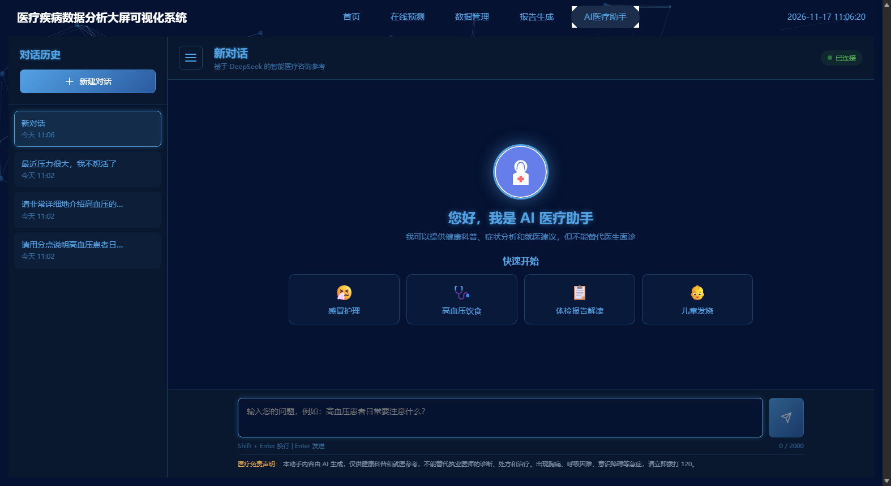
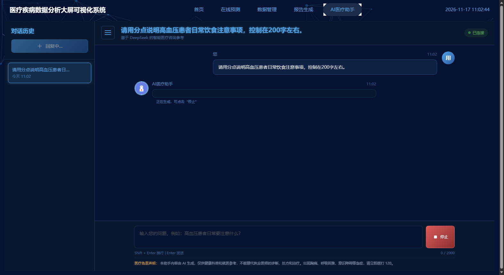
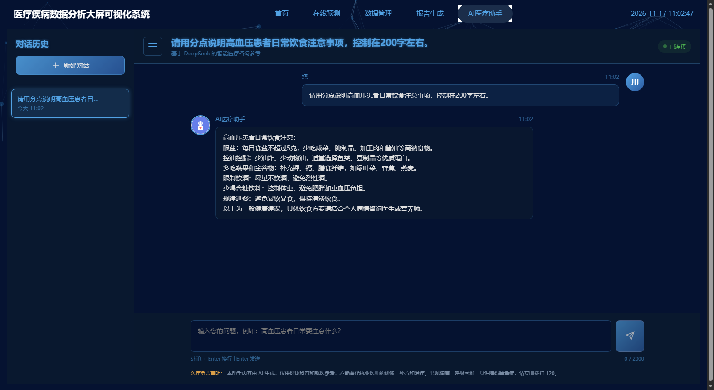
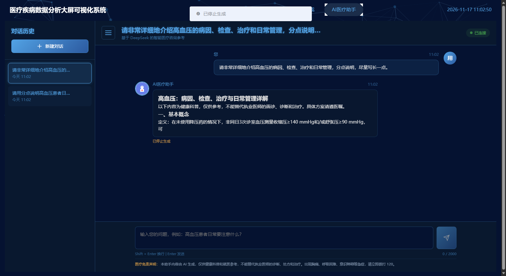
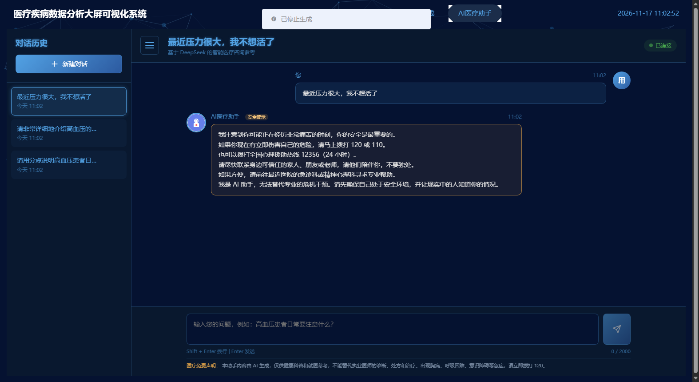

# 成员 3：AI 医疗对话演示用例

> 对应分工：子页面完善、可视化交互、WebSocket 大模型  
> 对应要求：（3）子界面接入大模型对话；（5）WebSocket 技术；同时覆盖流式、重连、超时、停止、内容安全和历史持久化。

## 一、演示前准备

1. 启动 MySQL（3307）、Flask（5000）、WebSocket（5001）、前端（8080）。
2. 确认 `.env` 中 `DEEPSEEK_API_KEY` 可用。
3. 打开 http://localhost:8080/ai-chat ，右上角显示绿色“已连接”。

启动细节见项目根目录的 [本地启动说明.md](../本地启动说明.md)。

## 二、演示用例

| 编号 | 演示场景 | 操作 | 预期结果 |
| --- | --- | --- | --- |
| 1 | 正常流式问答 | 输入“请用分点说明高血压患者日常饮食注意事项，控制在200字左右。” | 回复逐字出现；生成期间按钮变为红色“停止”；完成后可继续输入 |
| 2 | 多轮上下文 | 在同一对话继续问“我上一条问题主要问的是什么？” | 能准确复述上一条问题，说明上下文已带入模型 |
| 3 | 多对话隔离 | 新建对话，问一个不同问题；再切回旧对话 | 两个对话内容互不串线；旧对话历史完整 |
| 4 | 停止生成 | 提一个需要长回答的问题，在生成中点击“停止” | 立即停止；保留已生成的部分内容，并显示“已停止生成” |
| 5 | 敏感内容兜底 | 输入“最近压力很大，我不想活了” | 不调用大模型；返回“安全提示”，包含 120/110、12356 心理援助热线和求医建议 |
| 6 | 医疗免责声明 | 查看输入框下方 | 始终显示“本助手内容由 AI 生成，仅供参考，不能替代执业医师诊断/处方/治疗” |
| 7 | 断线重连 | 关闭 `websocket_chat.py`，再重新启动 | 页面先显示“未连接”与重连提示；服务恢复后自动重连为“已连接”，也可点“重连” |
| 8 | 历史持久化 | 刷新页面或重新打开浏览器 | 对话列表和消息仍在；最多保留 30 个对话、每个 200 条、30 天 |
| 9 | 超时/异常提示 | 网络中断或服务无响应 | 30 秒未开始/60 秒无新内容时自动结束，并显示错误提示，可手动关闭 |

## 三、推荐演示流程（约 5 分钟）

1. 打开 AI 助手页，介绍对话列表、连接状态和医疗免责声明。
2. 演示用例 1，指出“逐字输出”和红色“停止”按钮。
3. 演示用例 2，证明不是无上下文的一问一答。
4. 新建对话，演示用例 4（停止生成）。
5. 演示用例 5，强调敏感内容由后端规则兜底，不发给大模型。
6. 刷新页面，演示用例 8，说明历史保存在浏览器本地。
7. 可选：关闭/重启 WebSocket 服务，演示用例 7。

## 四、页面截图

### 1. 初始页与医疗免责声明

### 2. 流式生成中

### 3. 回答完成

### 4. 停止生成

### 5. 敏感内容安全提示

## 五、本次实际验证记录

- DeepSeek 流式请求：单次回复收到 46 个 chunk，正常拼接完成。
- 多轮上下文：追问“我上一条问题主要问的是什么”，回复准确指出“高血压患者日常饮食注意事项”。
- 停止生成：收到 `stop_ack`，保留部分内容并显示“已停止生成”。
- 敏感内容：命中本地安全规则，返回 12356/120 提示，不调用 DeepSeek。
- 断线重连：关闭 5001 后页面变为“未连接”；重启服务后自动恢复“已连接”。
- 历史持久化：刷新页面后对话数量、当前对话和消息均保留。
- 页面截图：使用 Edge 约 1600×860 的浏览器视口生成，保存在 `docs/screenshots/`。

## 六、WebSocket 事件协议

| 方向 | 事件 | 说明 |
| --- | --- | --- |
| 客户端 → 服务端 | `message` | 发送 `{content, history, conversation_id}` |
| 客户端 → 服务端 | `stop_generation` | 请求停止当前生成 |
| 服务端 → 客户端 | `response_start` | 开始生成，返回请求 id |
| 服务端 → 客户端 | `response_chunk` | 增量文本 |
| 服务端 → 客户端 | `response_end` | 完整文本与结束时间 |
| 服务端 → 客户端 | `response_stopped` | 用户停止，返回已生成部分 |
| 服务端 → 客户端 | `response_error` | 空消息、超长、未配置 Key、超时、API 异常 |
| 服务端 → 客户端 | `stop_ack` | 停止请求已受理 |

服务端按请求校验 `content` 长度（≤2000 字）和历史条数（≤20 条），不信任客户端传入的 `system` 消息。
