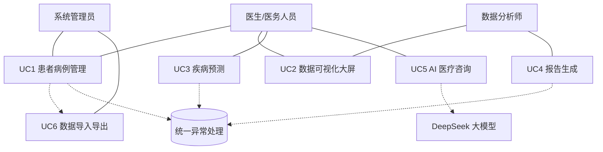
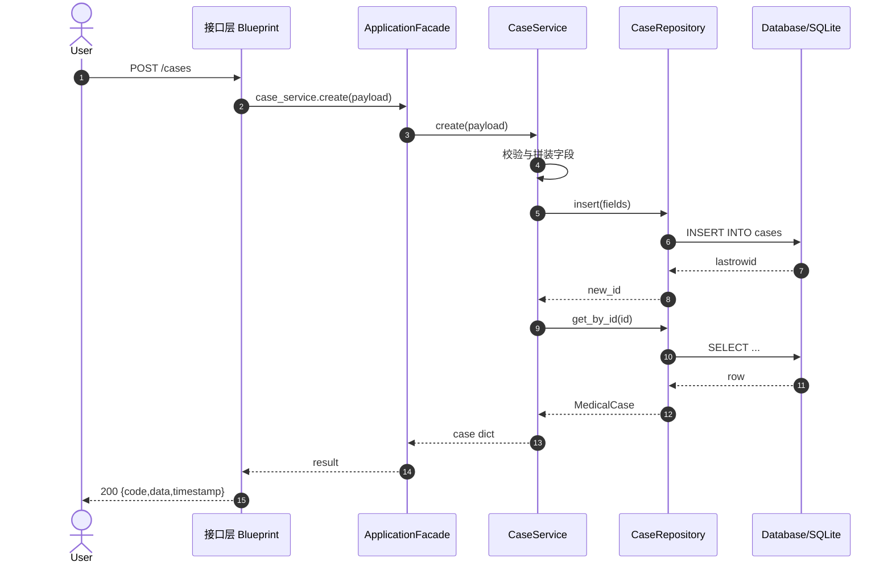
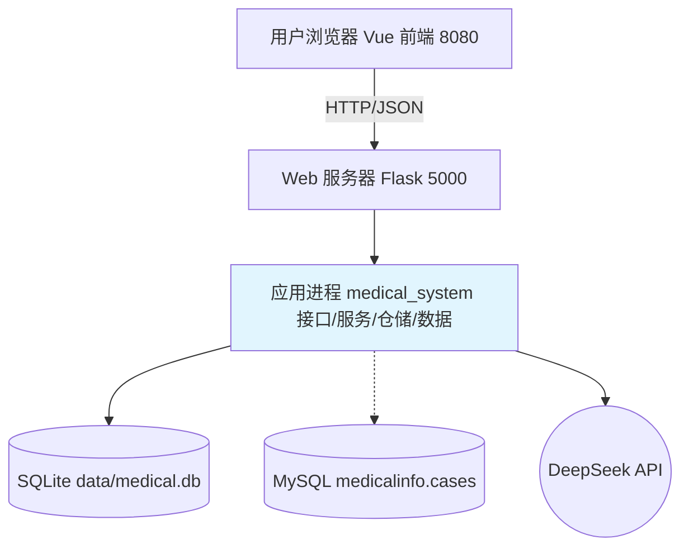

# UML 设计图（Mermaid 渲染版）

以下为 PlantUML 源（`docs/diagrams/*.puml`）的 Mermaid 对照，可直接在支持 Mermaid 的平台渲染。

## 1. 用例图



## 2. 类图

```mermaid
classDiagram
    class MedicalCase{
      +id:int
      +type:string
      +gender:string
      +age:int
      +time:string
      +content:string
      +docName:string
      +docHospital:string
      +department:string
      +detailUrl:string
      +height:float
      +weight:float
      +illDuration:string
      +allergy:string
    }
    class ReportTemplate{
      +id:int +name:string +sections:string +status:string +created_at:string
    }
    class Settings<<singleton>>{
      +instance():Settings
    }
    class Database<<singleton>>{
      +get_connection() +initialize()
    }
    class BaseRepository<<repository>>{
      +list_all() +get_by_id() +count() +insert() +update() +delete() +group_count()
    }
    class CaseRepository<<repository>>{
      +search() +count_search() +recent() +all_content()
    }
    class TemplateRepository<<repository>>{
      +list_by_status() +create() +set_status()
    }
    class ApplicationFacade<<facade,singleton>>{
      +instance() +case_service +statistics_service +prediction_service +report_service +consultation_service
    }
    class CaseService<<service>>{ +page() +get() +create() +update() +delete() +export_csv() +import_csv() }
    class StatisticsService<<service>>{ +dashboard() }
    class PredictionService<<service>>{ +predict() }
    class ReportService<<service>>{ +list_templates() +create_template() +generate() +export_docx() }
    class ConsultationService<<service>>{ +chat() }
    class ApiResponse{ +success() +error() }
    class BizException<<exception>>{}
    class ParamException<<exception>>
    class NotFoundException<<exception>>

    BaseRepository <|-- CaseRepository
    BaseRepository <|-- TemplateRepository
    CaseRepository ..> CaseService
    TemplateRepository ..> ReportService
    ApplicationFacade ..> CaseService
    ApplicationFacade ..> StatisticsService
    ApplicationFacade ..> PredictionService
    ApplicationFacade ..> ReportService
    ApplicationFacade ..> ConsultationService
```

## 3. 时序图（新增病例）



## 4. 活动图（疾病预测）

```mermaid
flowchart TD
    A[用户提交病情描述] --> B{content 是否为空?}
    B -- 是 --> C[返回 400 参数错误]
    B -- 否 --> D[门面调用 PredictionService.predict]
    D --> E{模型已训练?}
    E -- 否 --> F[读取病例，TF-IDF+朴素贝叶斯训练]
    F --> G[输入文本向量化并预测疾病/置信度]
    E -- 是 --> G
    G --> H[计算与历史病例余弦相似度 Top3]
    H --> I[生成健康建议]
    I --> J[返回 {disease,confidence,advice,similarCases}]
```

## 5. 部署图



详细 PlantUML 源文件请见 `docs/diagrams/*.puml`。
